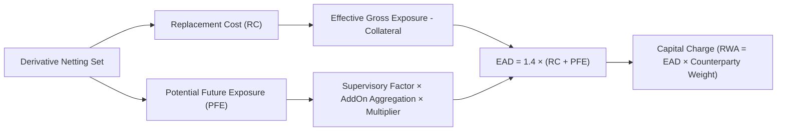

The Reserve Bank of India (RBI) has issued its comprehensive mandate transitioning commercial banks and institutional derivative market participants from the legacy Current Exposure Method (CEM) to the **Standardised Approach for Counterparty Credit Risk (SA-CCR)**.

In this executive video briefing, we deconstruct the regulatory mechanics, the mathematical formulation behind Exposure at Default ($EAD$), and how Indian treasury desks must adapt their margin operations and capital allocation frameworks.

---

## Executive Video Briefing

Watch the full analysis below on our official channel [**@RohitCurio**](https://www.youtube.com/@RohitCurio):

> [!NOTE]
> **Key Takeaway for Treasury & Risk Desks:** SA-CCR is fundamentally more risk-sensitive than CEM. While hedged and well-collateralized netting sets will experience significant capital relief, unmargined, directional, or non-linear derivative portfolios face substantial capital step-ups.

---

## 1. Why the Shift from CEM to SA-CCR?

For years, Indian banks utilized the **Current Exposure Method (CEM)**, a framework designed under Basel II that suffered from severe structural limitations:

1. **Insensitivity to Hedging & Netting:** CEM applied crude add-on percentages to gross or coarsely netted notional amounts, failing to adequately differentiate between directional speculative trades and delta-neutral hedges.
2. **Poor Margin Recognition:** The velocity, quality, and threshold frequency of Variation Margin (VM) and Initial Margin (IM) were poorly reflected in capital requirements.
3. **Maturity & Volatility Blind Spots:** CEM failed to factor in trade-level supervisory duration factors and collateral volatility haircuts dynamically.

**SA-CCR resolves these imbalances** by aligning regulatory capital directly with true economic risk exposure.

---

## 2. The Core Mathematical Framework

Under SA-CCR, the counterparty **Exposure at Default ($EAD$)** for a given netting set is determined by:

$$EAD = 1.4 \times (RC + PFE)$$

Where:
* **$1.4$ ($\alpha$-multiplier):** The Basel supervisory scalar reflecting model uncertainty, correlation risks during systemic crises, and wrong-way risk.
* **$RC$ (Replacement Cost):** The current mark-to-market exposure net of available collateral.
* **$PFE$ (Potential Future Exposure):** The risk-weighted add-on capturing market volatility over the liquidation or margin period of risk (MPOR).



---

## 3. Dissecting Replacement Cost ($RC$)

The computation of Replacement Cost bifurcates based on whether the netting agreement is margined or unmargined:

### For Margined Netting Sets
$$RC = \max\left(V - C,\; TH + MTA - NICA,\; 0\right)$$

* $V$: Current market value of derivative contracts in the netting set.
* $C$: Current collateral held by the bank (net of haircuts).
* $TH$: Minimum threshold amount above which margin calls are triggered.
* $MTA$: Minimum Transfer Amount.
* $NICA$: Net Independent Collateral Amount (such as segregated Initial Margin).

### For Unmargined Portfolios
$$RC = \max(V - C,\; 0)$$

If collateral exceeds current exposure, $RC$ drops to zero, but can never become negative to offset $PFE$.

---

## 4. Potential Future Exposure ($PFE$) and The Multiplier

The $PFE$ component is governed by an aggregate regulatory add-on adjusted by a non-linear collateral recognition multiplier:

$$PFE = \text{Multiplier} \times AddOn^{aggregate}$$

### The Multiplier Function
$$\text{Multiplier} = \min\left(1,\; 0.05 + 0.95 \times \exp\left(\frac{V - C}{1.9 \times AddOn^{aggregate}}\right)\right)$$

* When a portfolio is deeply **over-collateralized** ($V - C \ll 0$), the exponential term shrinks toward zero, reducing the multiplier to its statutory floor of **$0.05$ (a 95% reduction in the PFE add-on)**.
* When a portfolio is **under-collateralized** ($V > C$), the multiplier approaches **$1.0$**, exposing the bank to the full brunt of the regulatory add-on.

```
+--------------------------------------------------------------------+
|               SA-CCR COLLATERAL MULTIPLIER REGIME                  |
+--------------------------------------------------------------------+
|  Over-Collateralized (V - C < 0)  |  Floor: 0.05 (95% relief)      |
|  Par / Zero-Collateral (V = C)    |  Multiplier ~ 1.0              |
|  Uncollateralized (V - C > 0)     |  Multiplier Caps at 1.0        |
+--------------------------------------------------------------------+
```

---

## 5. Strategic Implications for Indian Bank Treasury Desks

The operational and capital consequences of RBI's SA-CCR mandate span the entire trading lifecycle:

1. **Bilateral Margin Adoption:** Treasuries must accelerate the migration of corporate and NBFC derivative trades under standardized Credit Support Annexes (CSAs) featuring zero thresholds and daily variation margin calls.
2. **Central Clearing Incentives:** Exposure to Qualifying Central Counterparties (QCCPs) such as CCIL enjoys preferential capital treatment ($EAD$ with a $2\%$ risk weight), creating a powerful economic incentive to clear standard FX and Interest Rate Swaps.
3. **Trade Compression & Netting Hygiene:** Because $PFE$ incorporates supervisory delta and maturity hedging sets within asset classes (e.g., MIBOR OIS curves), active trade compression and portfolio reconciliation significantly reduce gross notional drag.
4. **Pre-Deal Marginal Capital Pricing:** XVA desks must incorporate SA-CCR capital consumption directly into derivative pricing via Capital Valuation Adjustment (KVA).

---

## Watch the Video & Join the Discussion

To explore the numerical illustrations and step-by-step balance sheet sensitivity breakdowns, watch the complete briefing on YouTube:

👉 [**Watch: Decoding RBI's SA-CCR Mandate on YouTube**](https://youtu.be/qunVwBTbdWo)  
🔔 **Subscribe to [Rohit Curiosity (@RohitCurio)](https://www.youtube.com/@RohitCurio)** for upcoming deep dives into Treasury Risk, Quantitative Finance, and Macro Capital Markets.
