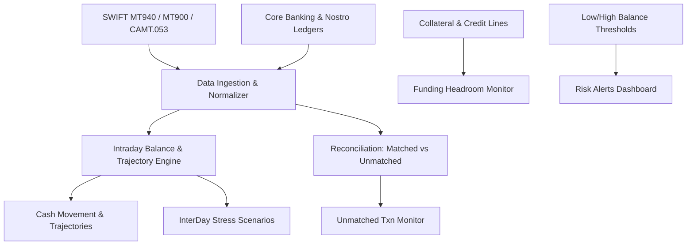

# Intraday Liquidity Analytics Zoho Concept

Regulatory compliance under **Basel Committee on Banking Supervision (BCBS 248)** mandates that commercial and investment banks actively monitor, control, and forecast their intraday liquidity positions. In high-velocity interbank settlement networks (such as Fedwire, CHAPS, TARGET2, and Lynx), liquidity is not static; it fluctuates continuously throughout the business day as payments, securities trades, and central bank intraday credit facilities evolve.

This project delivers a multi-dimensional proof-of-work implementation deployed across **9 integrated dashboards on Zoho Analytics**, backed by production-grade simulated transaction feeds from global banking hubs (Germany, Luxembourg, UK, and Americas).

---

## 🎯 Executive Dashboard Directory & Direct Links

Below is the structured directory of all 9 dashboards. Each link opens the corresponding live interactive view in Zoho Analytics:

### 1. [Cash Movement & Expectations](https://analytics.zoho.in/open-view/139442000000241658)
- **Data Stream:** Nostro Statements (MT940) & Scheduled Payment Feeds
- **Core Role:** Tracks the intraday cash trajectory by juxtaposing opening balances, anticipated receipts/payments, and actual settled flows. Highlights the acute 11:30–13:30 liquidity dip driven by large institutional settlement outflows.
- **Key Visuals:** Dual-line balance charts, net flow step charts, and expectation reconciliation tables.

### 2. [IDL - Cash Movement Dashboard](https://analytics.zoho.in/open-view/139442000000241779)
- **Data Stream:** Multi-Entity Intraday Nostro Balance Feeds
- **Core Role:** 30-minute interval step trajectory tracking **Available Balances** (`BC_AVA_BAL`) and **Projected Balances** (`BC_PRJ_BAL`) converted to Base Currency (USD) across global legal entities.
- **Key Visuals:** Time-stepped liquidity curves, entity-level position overlays, and currency bucket matrices.

### 3. [IDL - Funding Sources](https://analytics.zoho.in/open-view/139442000000261137)
- **Data Stream:** Central Bank Facilities & Depository Collateral Summary Feeds
- **Core Role:** Real-time visibility into the bank's intraday liquidity buffer. Compares Start-of-Day (BoD) Cash, Committed Credit Line headroom, and Free vs. Pledged Collateral across depositories (EuroClear, BONY, ASX, TSE).
- **Key Visuals:** Collateral headroom waterfalls, credit line utilization dials, and asset pledge monitors.

### 4. [Unmatched Transaction Monitor](https://analytics.zoho.in/open-view/139442000000239233)
- **Data Stream:** RTGS Clearing & Real-Time Settlement Queue Feeds
- **Core Role:** Surveillance of unsettled debit (`UMD`) and credit (`UMC`) transactions. Essential for preventing cutoff breaches and identifying counterparty settlement bottlenecks before market close.
- **Key Visuals:** Unmatched vs. Matched transaction breakdown, queue status alerts, and cutoff horizon clocks.

### 5. [Alerts Dashboard](https://analytics.zoho.in/open-view/139442000000508238)
- **Data Stream:** Nostro Threshold Monitoring & Exception Feeds
- **Core Role:** Real-time risk governance monitoring 39 active threshold events, including 20 High-Severity Low-Balance (`LBAL`) warnings and 19 High-Balance (`HBAL`) surplus notifications across correspondent nostro accounts.
- **Key Visuals:** Incident severity matrices, legal entity alert heatmaps, and nostro account breach logs.

### 6. [IDL - Securities Movement Dashboard](https://analytics.zoho.in/open-view/139442000000256603)
- **Data Stream:** Custodial Securities Ledgers & ISIN Settlement Feeds
- **Core Role:** Intraday monitoring of securities positions, repo collateral allocations, and settled vs. pending security trade executions at the ISIN level.
- **Key Visuals:** ISIN market value trajectories, buy/sell trade volume breakdowns, and depository allocation bars.

### 7. [Pivot View - Cash Movements & Alerts](https://analytics.zoho.in/open-view/139442000000267241)
- **Data Stream:** Consolidated Multi-Jurisdiction Nostro Matrix
- **Core Role:** Cross-entity multi-currency pivot matrix summarizing net cash positions and alert frequency across jurisdictions (America, Europe, Eurozone).
- **Key Visuals:** Dynamic pivot tables with drill-down hierarchies and conditional formatting.

### 8. [InterDay Projection / Stress Scenarios](https://analytics.zoho.in/open-view/139442000000258352)
- **Data Stream:** Counterparty Delay Profiles & Forward Liquidity Shocks
- **Core Role:** Stress testing engine evaluating how delays from key counterparties (e.g. WestPac, Wells Fargo, BHP Billiton) impact net intraday funding needs.
- **Key Visuals:** Stress scenario curves, liquidity gap forecasts, and simulated credit facility draws.

### 9. [Pivot View - Securities Movement](https://analytics.zoho.in/open-view/139442000000255221)
- **Data Stream:** Custodial Segregation & Depository Allocation Feeds
- **Core Role:** Custodial pivot view categorizing proprietary ("Owned") versus "Client-Pledged" assets across clearing depositories.
- **Key Visuals:** Segregated custody balance matrices and collateral pledge status overviews.

---

## 🏛️ Domain Architecture: The Intellect IDL Paradigm

The architecture follows the **Intellect Active Intraday Liquidity Management** framework:

### Key Analytical Rules
1. **Intraday Liquidity Gap ($G_{t}$):**
   $$G_t = \text{Balance}_0 + \sum_{\tau=0}^{t} \left(\text{Credit}_\tau - \text{Debit}_\tau\right)$$
   Where a negative $G_t$ signifies intraday overdraft reliance.
2. **Buffer Sufficiency Condition:**
   $$\text{Cash Buffer} + \text{Committed Credit Line} + \text{Unencumbered Collateral} \ge \max_{t} |G_t^-|$$
   If this inequality is satisfied, the institution bears **Zero Structural Liquidity Risk**.

---

## 🔍 Evaluation & Next Evolution

While the Zoho Analytics dashboards provide enterprise BI convenience, embedding them into a modern dark-mode Jamstack site introduces visual styling mismatches, iframe scrollbars, and heavy bundle footprints. To provide a superior user experience, explore our companion tile: **[Intraday Liquidity Analytics with Plotly Concept](#portfolio/intraday-liquidity-analytics-plotly-concept)**.
